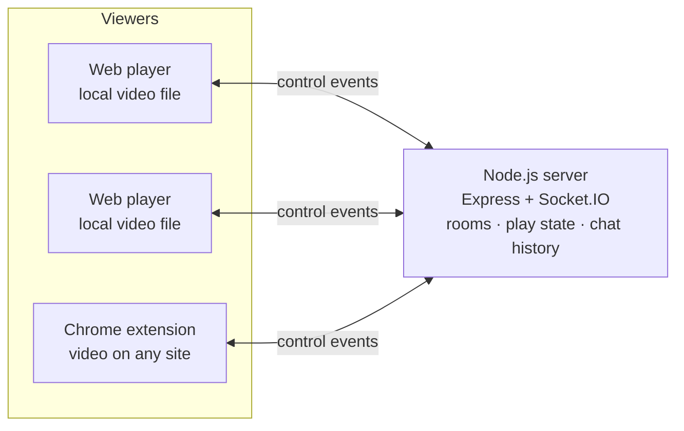
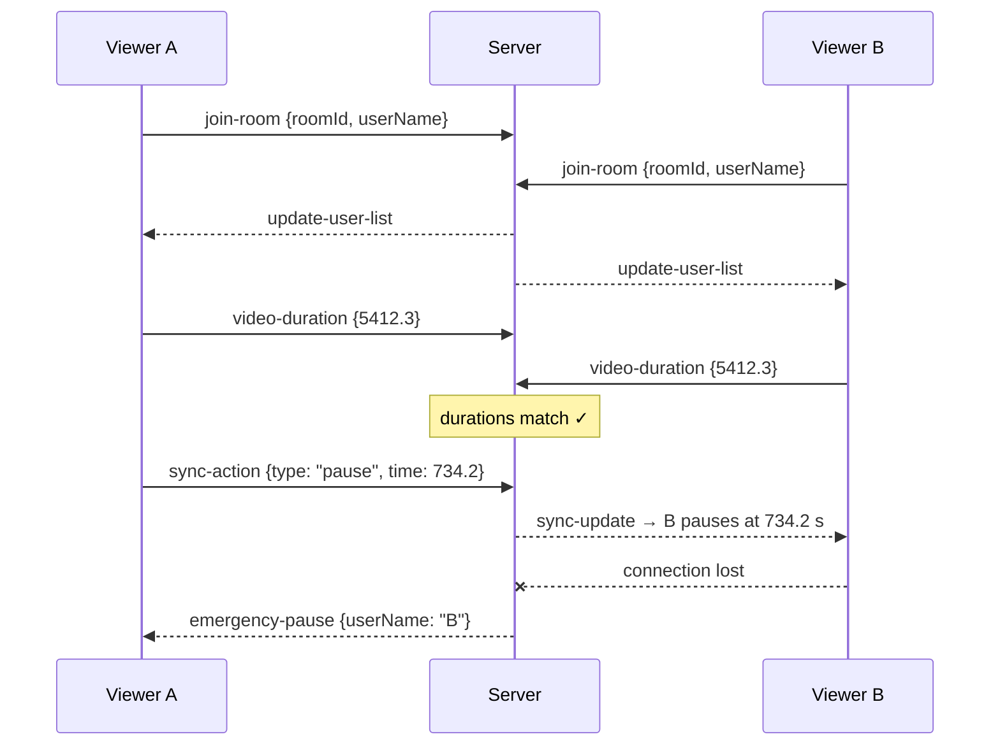

# 🔥 HD Yakishi Cehennemi

**Watch videos together from different places, in perfect sync.**

A real-time co-watching platform. Everyone in a room watches the same video; when one person plays, pauses or seeks, everyone else follows instantly. On top of playback there is a chat, live cursors, a shared drawing layer and emoji reactions, so it feels like sitting on the same couch.


https://github.com/user-attachments/assets/4f0bf727-ee3e-4f55-bd04-71ad858db0ea

---

## Two ways to watch together

| | How it works | Best for |
|---|---|---|
| **Web player** (this repository) | Everyone opens the site and picks the same video file from their own computer | Films and videos you already have on disk |
| **[Chrome extension](https://github.com/Yexsea/HDYakishiCehennemi-Chrome)** | A floating panel on top of any website's video player | Videos on streaming sites and other web players |

Both clients talk to the same Socket.IO server in this repository, so the sync, chat, cursors and reactions work the same way in both.

## Highlights

- **Instant playback sync** for play, pause and seek, including keyboard jumps
- **Auto-pause on disconnect**: if anyone drops, everyone pauses and sees who dropped, so nobody gets ahead
- **Same-file check**: the server compares video durations and warns viewers whose file doesn't match
- **Together features**: chat with typing indicator, live cursors, shared drawing over the video, emoji reactions with a hidden combo
- **Polished player**: ambilight glow, volume boost up to 200%, cinema mode, a separate mobile layout for Android and iOS
- **Resilient connection**: Socket.IO connection-state recovery rides out short network drops without kicking anyone out

## Why it's built this way

**The video never travels through the server.** In the web player each viewer opens their own copy of the file; only tiny control messages (`pause at 734.2 s`) cross the network. That design choice gives:

- near-zero bandwidth and hosting cost, even for full-length HD films (the server runs on a free hosting tier)
- no buffering differences between viewers caused by streaming
- nothing uploaded, nothing stored, nothing to moderate

The trade-off is that everyone needs the same file, which is why the server checks durations and warns on a mismatch.

## Features in detail

### Playback sync
- Room-based sessions: join with a display name and a room name (both remembered in `localStorage`)
- Play, pause and seek are broadcast to the rest of the room; ±5 s keyboard jumps are synced too
- A guard flag stops "echo loops", where applying a remote pause would otherwise trigger a new pause event
- When someone disconnects, the server tells the room to pause and shows a banner with the person's name

### Together features
- **Chat** with typing indicator and system messages (joins, drops)
- **Live cursors**: share your mouse position; positions are sent as percentages so they line up on any screen size
- **Shared drawing**: draw on a canvas layer on top of the video; strokes appear for everyone
- **Reactions**: ❤️ 😂 😲 👏 🔥 float up the screen, and pressing all five in order triggers a secret combo

### Player
- Ambilight-style glow around the video, drawn on a canvas
- Volume up to 200% through a Web Audio `GainNode`
- Cinema mode and a dedicated mobile layout with touch controls
- Drag and drop a file onto the player, keyboard shortcuts, fullscreen
- Reconnect overlay when the connection drops

### Server
- Express serves the client; Socket.IO handles all real-time events
- Socket.IO **connection state recovery** (up to 2 minutes) plus a 2-second ping interval
- Keeps each room's latest playback state and last 50 chat messages
- Compares the video duration reported by each viewer (5-second tolerance)
- Compares the page URL reported by extension users and warns when people are on different pages
- The extension sends a heartbeat every 25 seconds; if the server lost track of a socket, the heartbeat re-registers it in its room
- Cleans up all room state when the last person leaves

### Security
- Every event is validated on the server: types, number ranges, text length, allowed reaction emojis and colors
- A client can only send events to the room it actually joined; the room in the message is ignored
- The sender's name comes from the server's own record, so nobody can post under someone else's name
- Per-connection rate limits for chat, drawing, cursors and reactions; messages are capped at 64 KB
- Both clients insert chat text and names as plain text, never as HTML

## Architecture





### Socket events

| Direction | Event | Purpose |
|---|---|---|
| client → server | `join-room` | Enter a room with a display name |
| client → server | `sync-action` | Play / pause / seek with timestamp |
| server → room | `sync-update` | Apply the same action |
| client → server | `video-duration` | Report file length for the same-file check |
| server → client | `duration-error` | Your file doesn't match the room's |
| client → server | `page-url` | Report the current page (extension) |
| server → client | `url-mismatch` | You are on a different page than the others |
| server → room | `emergency-pause` | Someone disconnected, pause everyone |
| client → server | `heartbeat` | Keep-alive and automatic room re-join |
| both ways | `send-message` / `receive-message` | Chat |
| both ways | `typing-start` / `typing-stop` / `user-typing` | Typing indicator |
| both ways | `mouse-move` / `mouse-update` / `remove-cursor` | Live cursors |
| both ways | `draw-line` | Shared drawing |
| both ways | `send-reaction` / `show-reaction` | Emoji reactions |
| server → room | `update-user-list` | Who is in the room |

## Run it locally

Requires Node.js 18 or newer.

```bash
git clone https://github.com/Yexsea/HDYakishiCehennemi.git
cd HDYakishiCehennemi
npm install
npm start          # → http://localhost:3000
```

Open the page in two browser windows (or on two devices on the same network), enter the same room name in both, and pick the same video file. Pause in one window and watch the other follow.

### Deploy

Any Node.js host works. The live server runs on Render with the start command `npm start`; the port comes from the `PORT` environment variable.

<!-- Canlı link eklemek istersen yorum işaretlerini kaldır. Uyarı: varsayılan oda adı "Yakishi" olduğu için başkaları senin odana girebilir; önce varsayılanı değiştir.
**Live:** https://hdyakishicehennemi.onrender.com (free tier: the first visit may take a moment to wake the server)
-->

### Keyboard shortcuts

| Key | Action |
|---|---|
| `Space` | Play / pause (synced) |
| `←` / `→` | Back / forward 5 seconds (synced) |
| `↑` / `↓` | Volume |
| `F` | Fullscreen |
| `C` | Toggle chat |

## Project structure

```
├── server.js          # Express + Socket.IO: rooms, sync, chat history, duration & URL checks
├── public/
│   ├── index.html     # The whole web client: player, chat, cursors, drawing (vanilla JS)
│   ├── acilis.mp4     # Intro animation
│   └── simgecik.png   # App icon
└── package.json
```

The interface text is in Turkish.

## Roadmap

- [ ] Use the stored room state on the client so late joiners jump straight to the current position and see recent chat
- [ ] Show connection quality next to each name in the user list
- [ ] Restrict the CORS origin (currently `*`)
- [ ] Redis adapter so several server instances can share rooms
- [ ] Automated tests for the sync logic

## Related

- **[HD Yakishi Cehennemi for Chrome](https://github.com/Yexsea/HDYakishiCehennemi-Chrome)**: the browser extension client
